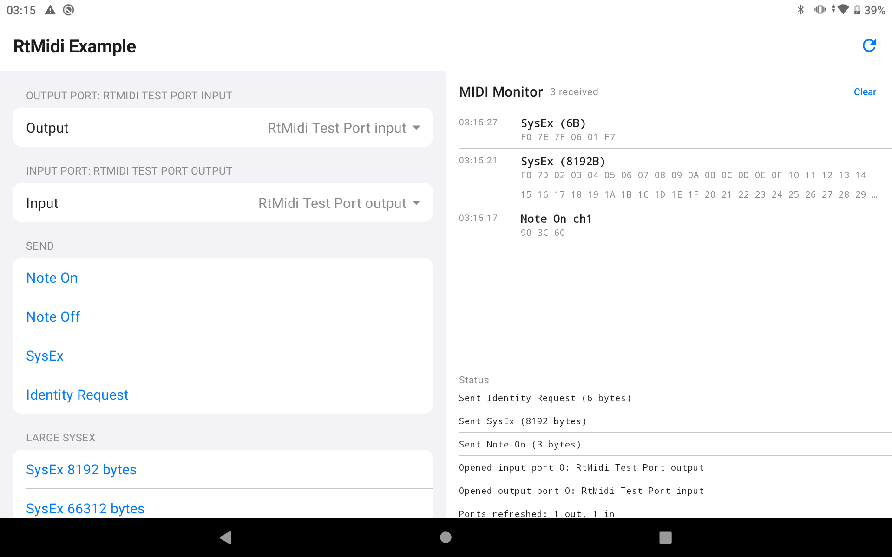

# Example Android Studio project

Simple app using RtMidi. It uses these files from the main RtMidi project:
* RtMidi.cpp and RtMidi.h, symlinked into `app/src/main/cpp`
* the Java classes in `contrib/java`, which `app/build.gradle` adds as a source
  directory

The main goal of this project is to demonstrate how to build RtMidi into an Android app. The
app mirrors the iOS example (`examples/ios`): it lists MIDI ports, sends Note On/Off, SysEx and
an Identity Request, and shows received MIDI in a monitor with basic Identity Reply decoding.
It can also send large SysEx messages, and ask for USB access so RtMidi can show each USB
device's own port names.

The code has the same three parts as the iOS example:
* `app-jni.cpp` and `RtMidiBridge.kt`: a thin wrapper over one `RtMidiIn` and one `RtMidiOut`
* `MidiController.kt`: the app's state and logic
* `MainActivity.kt`: the user interface, in Jetpack Compose



## Using RtMidi in your own app

Two things are easy to miss:

**`MidiDeviceOpenedListener.java` has to be in your APK.** The Android MIDI API
opens devices asynchronously through a Java listener, so the backend needs that
class at runtime, in package `com.yellowlab.rtmidi`. It ships in
`contrib/java/`. Without it, `openPort()` fails at once with an error saying
the class must be bundled. With it, ports can be opened from any thread,
including your own native threads.

**USB access is optional.** MIDI works without any permission. With USB access
to a device, RtMidi reads the device's own port names, and on Android 12 and
earlier its true number of input ports, which lets it refuse to open a device
that would hang the system. RtMidi never asks for access itself; to ask, include
`contrib/java/RtMidiUsbPermission.java` and call

    RtMidiUsbPermission.request(context, (granted, denied) -> { /* enumerate ports again */ });

That grant lasts until the device is unplugged. For one the system can
remember, declare `android.hardware.usb.action.USB_DEVICE_ATTACHED` with a USB
MIDI device filter, as this example's `AndroidManifest.xml` and
`res/xml/usb_midi_filter.xml` do.

**Do not construct an `RtMidiIn` or `RtMidiOut` in a static initializer.** A
static initializer runs while `System.loadLibrary()` is still loading your
library, before the JNI environment is usable. Construct on first use instead:

    static RtMidiIn* midiLib = NULL;

    static RtMidiIn* getMidiLib() {
        if ( midiLib == NULL )
            midiLib = new RtMidiIn( RtMidi::Api::ANDROID_AMIDI );
        return midiLib;
    }

## Testing SysEx receive with an RP2040

The Large SysEx section can also ask a device to send SysEx back, so receive gets tested as well as send. Only one device answers: PZ-Echo-4x4, a USB MIDI 2.0 test firmware that runs on a bare Raspberry Pi Pico, on the [`pz-echo-4x4-midi1-hosts`](https://github.com/Muse-Kinetics/AmeNote_Protozoa/tree/pz-echo-4x4-midi1-hosts) branch of our fork of the AmeNote ProtoZOA code. There's no prebuilt binary, so build it with a standard Pico SDK 2.x install (`PICO_SDK_PATH` set):

```
git clone -b pz-echo-4x4-midi1-hosts https://github.com/Muse-Kinetics/AmeNote_Protozoa.git
cd AmeNote_Protozoa
git -c url."https://github.com/".insteadOf="git@github.com:" submodule update --init
mkdir build && cd build && cmake .. -G Ninja -DPICO_BOARD=pico && ninja UUT_PZ_ECHO_4X4
```

Hold BOOTSEL while plugging the Pico in, then copy `build/UUT/PZ_Echo_4x4/UUT_PZ_ECHO_4X4.uf2` onto the drive that appears. Build this app with `./gradlew assembleDebug -PenableProtozoaEcho` to show the dump-request rows; each reply is checked byte by byte and the result goes to the status log.

## Building the library for Android

The Android backend must be built with CMake; the Autotools path does not
support it. Cross-compile with the NDK's CMake toolchain file:

```
cmake -B build-android \
  -DCMAKE_TOOLCHAIN_FILE=<ndk>/build/cmake/android.toolchain.cmake \
  -DANDROID_ABI=arm64-v8a -DANDROID_PLATFORM=android-29 \
  -DRTMIDI_API_AMIDI=ON
cmake --build build-android
```

`RTMIDI_API_AMIDI` defaults to on when the CMake toolchain sets `ANDROID`.

## Android USB MIDI Bugs and Broken Features

There are several USB MIDI-related bugs present in different versions of AOSP and the underlying Linux kernel(s):

| Feature | Android 10 to 12 (API 29 to 32) | Android 13 and later (API 33+) |
|---|---|---|
| Accurate device port counts | broken, the output count is also reported for inputs | fixed |
| Open a device with the same number of inputs and outputs | yes | yes |
| Open a device with fewer inputs than outputs (1/3, 0/2) | broken, opening it hangs, and the device is unusable by every app until unplugged | fixed |
| Open a device with more inputs than outputs (3/1) | broken, the extra inputs can't be seen | fixed |
| Open a device with no outputs (2/0) | broken, Android doesn't list it | fixed |
| USB port names | not provided | not provided |
| USB MIDI 2.0 device | yes, as MIDI 1.0 | may be missing (see below) |

How RtMidi handles this:

- **Android 10 to 12, with USB access to the device:** RtMidi reads the
  device's USB descriptors, so it reports the real number of inputs and the
  device's own port names, e.g. "QuNexus Control Surface". A device with fewer
  inputs than outputs is listed with its ports in parentheses, and RtMidi
  refuses to open it instead of hanging.
- **Android 10 to 12, without USB access:** RtMidi can only use Android's
  counts, and names ports "&lt;device&gt; MIDI &lt;n&gt;". Opening a device
  with fewer inputs than outputs gives up after 5 seconds with an explanation,
  but by then the device is stuck until it's unplugged. Ask for USB access
  (above) to avoid this.
- **Android 13 and later:** Android's counts are right and nothing hangs. RtMidi
  still reads the USB descriptors for port names when it has USB access.
- **MIDI 2.0:** RtMidi lists devices with `MidiManager.getDevices()`, which from
  Android 13 only returns devices that don't default to MIDI 2.0 (UMP), so a
  MIDI 2.0 USB device may be missing there. MIDI 2.0 support is planned for
  RtMidi 7.0.0.

The Android 13 column follows Android's source code; it hasn't been tested on
a device yet. Consider donating a modern Android tablet to the RtMidi developers
so we can add it to our hardware test fleet. If you're feeling generous, please
open an issue.

## Minimum API level

The Android backend requires **API 29** (Android 10), which is where the AMidi
NDK API was introduced.

Do not link `libnativehelper`. The JVM pointer is obtained from `JNI_OnLoad`,
falling back to `dlsym()` when the library was not loaded by the Java runtime.
Linking `libnativehelper` for `JNI_GetCreatedJavaVMs()` would raise the minimum
to API 31, since that is the first level the NDK ships it for.

Link `log`, `amidi` and `dl`.
